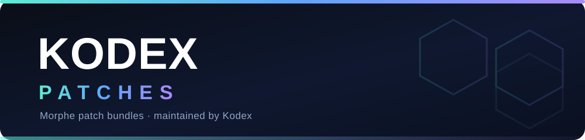

<div align="center">



# Kodex Patches

### Clean, update-resilient patch bundles for [Morphe](https://github.com/MorpheApp)

**Precision over volume.** A small, deliberately chosen set of patches — written the way the
Morphe ecosystem expects: minimal smali edits, fingerprints that survive app updates, and
real logic kept in extensions.

<br>

[](https://github.com/sabbirexist/kodex-patches/releases)
[](https://github.com/sabbirexist/kodex-patches/actions/workflows/release.yml)
[](LICENSE)
[](https://github.com/sabbirexist/kodex-patches/commits)

[](https://github.com/sabbirexist/kodex-patches/stargazers)
[](https://github.com/sabbirexist/kodex-patches/forks)
[](https://github.com/sabbirexist/kodex-patches/issues)
[](#)

<br>

<a href="https://morphe.software/add-source?github=sabbirexist/kodex-patches">
  
</a>

<br><br>

<sub>Not affiliated with the Morphe project · see <a href="NOTICE">NOTICE</a></sub>

</div>

---

## 📖 Table of contents

- [Overview](#-overview)
- [Highlights](#-highlights)
- [Patches](#-patches)
- [Installation](#-installation)
- [A note on signing](#️-a-note-on-signing)
- [Development](#-development)
- [Anatomy of a patch](#-anatomy-of-a-patch)
- [Roadmap](#️-roadmap)
- [Contributing](#-contributing)
- [Credits](#-credits)
- [License](#-license)

---

## 🚀 Overview

**Kodex Patches** is a personal patch project for [Morphe](https://github.com/MorpheApp) — the
Android patching framework that modifies apps by editing their Dalvik bytecode and decoded
resources, then repackaging and re-signing the result.

Every patch here follows the conventions of the Morphe open-source ecosystem. The goal is not to
ship the most patches — it is to ship patches that **still work after the app updates**. That means
targets are found by *behaviour* (return types, parameters, access flags, instruction filters),
never by obfuscated names, and anything non-trivial lives in a precompiled extension rather than in
hand-written smali.

Built on [Morphe Patcher](https://github.com/MorpheApp/morphe-patcher) · [smali](https://github.com/google/smali) · [Apktool](https://github.com/iBotPeaches/Apktool).

## ✨ Highlights

| | |
|---|---|
| 🎯 **Update-resilient** | Fingerprints match on stable traits, not names that rotate every release. Re-derive one filter, not the whole patch. |
| 🧩 **Minimal footprint** | Each patch injects the fewest instructions possible — a single hook where a hook will do. |
| 🔒 **Isolated logic** | Multi-line Java lives in the extension (`app.kodex.extension`), reached from smali in one call. |
| ⚙️ **Configurable** | Patches expose typed options where a choice matters — editable in Manager or via CLI. |
| 🚢 **Released properly** | Semantic-release on `dev`/`main`: `feat:`/`fix:` auto-cut pre-releases, verified builds ship stable. |
| ✅ **Verified, not assumed** | Patches are validated against a real APK — the compiled resource table / bytecode is diffed before push. |

---

## 🩹 Patches

<!-- PATCHES_START EXPANDED -->
> **[v1.1.0-dev.3](https://github.com/sabbirexist/kodex-patches/releases/tag/v1.1.0-dev.3)**&nbsp;&nbsp;•&nbsp;&nbsp;`dev`&nbsp;&nbsp;•&nbsp;&nbsp;10 patches total
<details open>
<summary>📦 VLC&nbsp;&nbsp;•&nbsp;&nbsp;10 patches</summary>
<br>

**🎯 Supported versions:**

| 3.7.1 |
| :---: |

| 💊&nbsp;Patch | 📜&nbsp;Description | ⚙️&nbsp;Options |
|----------|----------------|-----------|
| [AMOLED black theme](#amoled-black-theme) | Repaints every dark surface — background, cards, dialogs, popups, header and the navigation bar — to true black. |  |
| [Disable audio time-stretch](#disable-audio-time-stretch) | Forces time-stretching off for artifact-free playback at 1x speed. |  |
| [Force AAudio output](#force-aaudio-output) | Locks the audio output to AAudio (low latency), overriding the device preference. |  |
| [Force ReplayGain](#force-replaygain) | Normalizes loudness across tracks using track mode with peak protection. |  |
| [Force audio passthrough](#force-audio-passthrough) | Enables bitstream audio passthrough (digital output) to an external DAC or receiver. |  |
| [Raise network cache](#raise-network-cache) | Buffers 3 seconds of stream ahead to reduce stalls on flaky networks. |  |
| [Skip "What's New" dialog](#skip-what-s-new-dialog) | Suppresses the What's New changelog dialog shown after app updates. |  |
| [Skip onboarding](#skip-onboarding) | Skips the first-run onboarding and opens the app directly. |  |
| [Unlock experimental features](#unlock-experimental-features) | Enables every experimental feature flag regardless of its stored value. |  |
| [Verbose libVLC logging](#verbose-libvlc-logging) | Sets libVLC to maximum verbosity (-vvv) for troubleshooting playback. |  |

</details>

<!-- PATCHES_END -->

---

## 📲 Installation

### Morphe Manager (Android)

1. Open **Morphe Manager** → **Settings → Sources → Add source**.
2. Paste the repository URL:

   ```
   https://github.com/sabbirexist/kodex-patches
   ```

3. Enable **pre-release** on the source to pull `dev` builds (`v…-dev.N`), or leave it off for stable releases.

> Or tap the **Add to Morphe** button at the top of this page **on your Android device** — that
> deep-links straight into the app.

### Morphe Desktop (CLI)

Point `-p` at this repo and Morphe fetches the bundle from the latest release:

```bash
java -jar morphe-desktop-*-all.jar patch \
  -p https://github.com/sabbirexist/kodex-patches \
  --prerelease \
  -o VLC-Morphe.apk \
  VLC.apk
```

### Requirements

| | |
|---|---|
| **Device** | Any Android phone or tablet supported by the patched app |
| **Tool** | [Morphe Manager](https://github.com/MorpheApp) (Android) or [Morphe Desktop](https://github.com/MorpheApp/morphe-desktop) (CLI) |
| **Input** | The exact **app version** listed for the patch (matching versions apply more patches) |

## ⚠️ A note on signing

Morphe re-signs every patched APK with a key of its own, so the patched build **cannot install over
the original** — Android rejects a signature mismatch (*"App not installed"*). You have two options:

- **Uninstall the original app first**, then install the patched build (you lose its settings), or
- use a **rename patch** so the patched app installs side-by-side as a separate package.

---

## 🧑💻 Development

All work happens on the **`dev`** branch.

```bash
git clone https://github.com/sabbirexist/kodex-patches
cd kodex-patches

# requires JDK 21 + an Android SDK (compileSdk 36) + GitHub Packages auth (read:packages)
./gradlew buildAndroid
# -> patches/build/libs/patches-*.mpp
```

Apply the bundle locally with [Morphe Desktop](https://github.com/MorpheApp/morphe-desktop):

```bash
java -jar morphe-desktop-*-all.jar patch \
  -p patches/build/libs/patches-*.mpp \
  -i target.apk        # -i installs over ADB
```

### Project layout

```
patches/src/main/kotlin/app/kodex/patches/
├── shared/            # Compatibility declarations (app name, package, targets)
└── <app>/             # One package per target app
    ├── Fingerprints.kt
    └── <Feature>Patch.kt
extensions/extension/  # Precompiled DEX merged into the patched app at runtime
```

### Branch model

| Branch | Purpose | On push |
|--------|---------|---------|
| `dev`  | All development | `feat:`/`fix:` cut a pre-release (`v…-dev.N`) |
| `main` | Stable only | merge `dev` → `main` to ship a stable release |

### Commit convention

Semantic messages only — they drive the release:

| Type | Effect |
|------|--------|
| `feat: …` | new behaviour → **pre-release** |
| `fix: …`  | correction → **pre-release** |
| `chore: …`| internal change → **no release** |

Generated files (`patches-list.json`, `patches-bundle.json`, `CHANGELOG.md`) are owned by
`release.yml` — **never edit them by hand.**

---

## 🔬 Anatomy of a patch

A fingerprint describes a target method by its stable traits; a patch hooks it. Complex logic is
delegated to an extension class.

```kotlin
object AdsGateFingerprint : Fingerprint(
    returnType = "Z",
    parameters = listOf("Ljava/lang/String;", "I"),
    accessFlags = listOf(AccessFlags.PUBLIC, AccessFlags.FINAL),
    filters = listOf(
        string("showBannerAds"),
        methodCall(definingClass = "Ljava/lang/String;", name = "equals"),
        opcode(Opcode.MOVE_RESULT, InstructionLocation.MatchAfterImmediately()),
    )
)

val disableAdsPatch = bytecodePatch(
    name = "Disable ads",
    description = "Disables banner ads in the app.",
    default = true,
) {
    compatibleWith(COMPAT_APP)
    extendWith("extensions/extension.mpe")

    execute {
        AdsGateFingerprint.method.addInstructions(0, """
            invoke-static {}, Lapp/kodex/extension/AdsPatch;->shouldShowAds()Z
            move-result v0
            return v0
        """)
    }
}
```

Read the [patcher documentation](https://github.com/MorpheApp/morphe-patcher/blob/main/docs/README.md)
for the full API.

---

## 🗺️ Roadmap — all shipped

All patches target **VLC for Android** (`org.videolan.vlc`), verified against 3.7.1:

| Patch | What it does |
|-------|--------------|
| AMOLED black theme | True black across background, cards, dialogs, popups and the navigation bar |
| Skip "What's New" dialog | Suppresses the changelog popup after updates |
| Skip onboarding | Opens the app directly on first run |
| Unlock experimental features | Enables every experimental feature flag |
| Force audio passthrough | Bitstreams audio to an external DAC or receiver |
| Force AAudio output | Low-latency AAudio, overriding the device preference |
| Force ReplayGain | Track-mode loudness normalisation with peak protection |
| Disable audio time-stretch | Artifact-free playback at 1x speed |
| Raise network cache | 3 seconds of stream buffering to cut stalls |
| Verbose libVLC logging | `-vvv` output for troubleshooting playback |

Have a request? [Open a feature request](https://github.com/sabbirexist/kodex-patches/issues/new/choose).

---

## 🤝 Contributing

Contributions, bug reports, and feature requests are welcome — read [CONTRIBUTING.md](CONTRIBUTING.md)
and use the [issue templates](https://github.com/sabbirexist/kodex-patches/issues/new/choose).
Please include the **exact app version** and the **patches bundle version** in any report.

## 🙏 Credits

- [Morphe](https://github.com/MorpheApp) and [Morphe Patcher](https://github.com/MorpheApp/morphe-patcher) — the framework this is built on.
- [smali](https://github.com/google/smali) and [Apktool](https://github.com/iBotPeaches/Apktool) — the underlying bytecode and resource tooling.
- [VLC for Android](https://github.com/videolan/vlc-android) — the app this patch set currently targets.
- The ReVanced / Morphe patch community — conventions and reference implementations.

## ⚖️ License

Kodex Patches are licensed under the [**GNU General Public License v3.0**](LICENSE).

> **Not affiliated with, endorsed by, or sponsored by** the Morphe project. References to "Morphe"
> are descriptive compatibility only. Patched third-party apps retain their own licenses (for
> example, VLC is GPL); redistributing a patched build carries that app's source obligations.
> See [NOTICE](NOTICE) for details.

<div align="center">
<br>


<br>

<sub>Built with precision. Made for Morphe.</sub>

</div>
